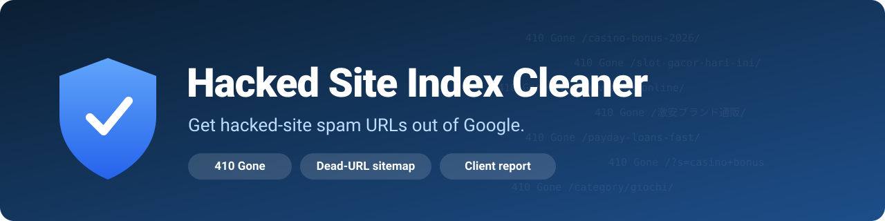
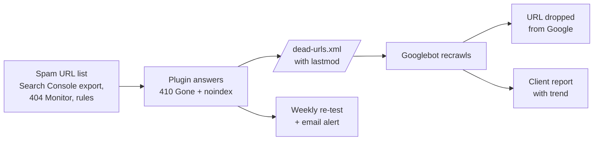
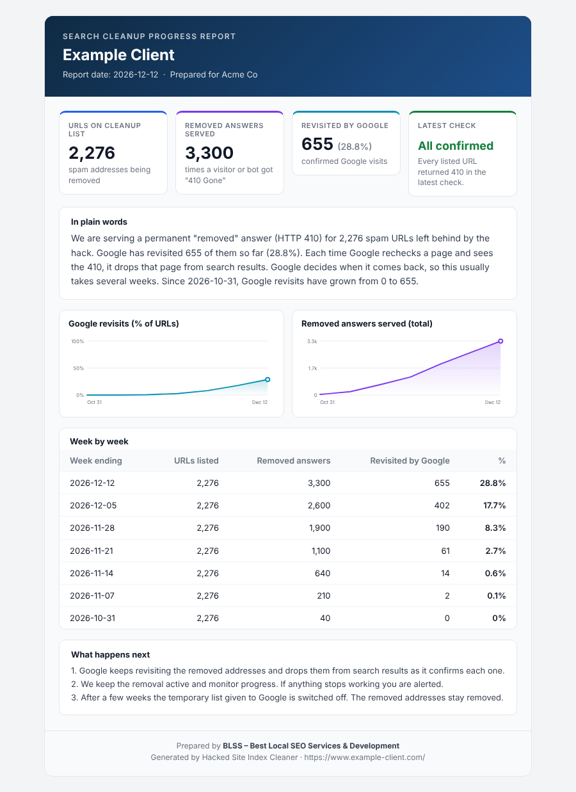

# Hacked Site Index Cleaner

**Remove hacked-site spam URLs from Google.** 
A free WordPress plugin that serves **410 Gone + noindex** for injected spam pages, gives Google a dead-URL sitemap to recrawl, and proves progress with a client-ready report.

[**Install**](#-install) · [**How it works**](#-how-it-works) · [**Features**](#-features) · [**Cleanup guide**](#-cleanup-guide) · [**FAQ**](#-faq)

> [!IMPORTANT]
> This plugin cleans up **Google's index** after a hack. It does **not** scan for or remove malware. Clean the site first, then use this.

---

## 🧨 The problem

After a WordPress hack (casino spam, pharma spam, Japanese keyword hack, doorway pages), thousands of spam URLs can stay in Google for months, even after the site is clean. They damage your brand in search, waste crawl budget and keep the "hacked" reputation alive.

Deleting the pages is not enough. Google needs a **clear, permanent "gone" signal** for every URL, and a reason to come back and see it.

## 🔧 How it works

## ✨ Features

| | |
|---|---|
| **🗂 URL manager** Paste URLs or upload CSV / TXT / XML. Search Console exports work as-is. Preview before import. | **🛡 Real-page guard** Published pages, the homepage, wp-admin, REST API and WooCommerce pages are never touched. |
| **🧩 Pattern rules** Remove whole groups: *starts with*, *contains* or *regex*, with a live preview of what is matched. | **🔎 404 Monitor** Logs missing URLs, scores them for spam (0–100) and adds them to the dead list in one click. |
| **🔍 Search spam protection** `/?s=casino-bonus` style URLs get 410 + noindex. Normal searches are untouched. | **🗺 Dead-URL sitemap** `/dead-urls.xml` with `lastmod`, auto-splits above 50,000 URLs, switches itself off on a date. |
| **👁 Googlebot tracking** Verified by reverse + forward DNS, so you see which URLs Google actually revisited. | **✅ Status tester** Checks every URL really returns 410. Weekly background re-test with an **email alert** if one stops. |
| **📄 Client report** One-page report with KPIs, trend charts and a weekly table. Print / save as PDF, or email weekly, monthly or quarterly. | **🏷 White-label friendly** Optional "Prepared by" branding, logo and client name on the report. |

<b>More detail</b>

**Safety**
- Real-page guard on import and again at request time; a page published later wins.
- Exact path matching for listed URLs; query strings are ignored.
- Rules refuse patterns that are too short or that also match ordinary pages (`about`, `contact`…).

**Search Console tools**
- Dashboard: URLs on the list, 410s served, "Revisited by verified Googlebot X / Y".
- CSV report and a URL list for the Removals tool.

**Technical**
- Purges WP Fastest Cache, LiteSpeed Cache, W3 Total Cache, WP Rocket and WP Super Cache when the list changes; 410 responses are never cached.
- Nonces, admin-only access, prepared queries. IPs are stored only as a salted hash; no IP address is stored by the 404 Monitor.
- No external calls and no tracking. Optional delete-all-data on uninstall.

## 📄 Client progress report

Send the site owner proof that the cleanup is working, without technical noise.

Example report with sample data.

## 🚀 Install

1. Download `hacked-site-index-cleaner-vX.Y.Z.zip` from the [**Releases**](../../releases) page.
2. In WordPress: **Plugins → Add New → Upload Plugin**, choose the zip, install and activate.
3. Open **Tools → Index Cleaner**.

> [!TIP]
> Use the zip from Releases. The green "Code → Download ZIP" button on GitHub creates a folder with a different name.

## 🧭 Cleanup guide

1. **Clean the site first** and make sure the spam pages are gone or no longer served as real content.
2. **Collect the spam URLs.** In Search Console: *Indexing → Pages*, tick *Unsubmitted pages only*, open the *Indexed* list and **Export**. Also check the plugin's **404 Monitor** for URLs the export missed.
3. **Import** in the plugin (*Add / Import*), check the preview, click Import. Add **rules** for URL patterns.
4. **Dashboard → Test all URLs.** Every URL should show 410.
5. Open a few spam URLs and two real pages in a private window to confirm.
6. In Search Console: **Sitemaps → add `dead-urls.xml` → Submit.**
7. Optionally use the **Removals** tool for the most visible spam URLs.
8. Watch **Indexing → Pages** and the plugin's Googlebot counter. Expect weeks, not days.
9. After 3–4 weeks, remove `dead-urls.xml` from Search Console. Keep the plugin active as long as you want the URLs to stay gone.

> [!WARNING]
> **Do not** block these URLs in `robots.txt`. Google must be able to crawl them to see the 410.

## 🆚 Why 410, and not 404, a redirect or robots.txt

| Method | Result |
|---|---|
| ✅ **410 Gone** | Clear, permanent "removed" signal. Google usually drops these fastest. |
| ⚠️ 404 Not Found | Works, but Google may keep rechecking for weeks. |
| ❌ 301 redirect to the homepage | Google can treat it as a soft 404 and keep the spam URL alive. |
| ❌ Blocking in robots.txt | Google can't crawl the URL, so it never sees the 410 and keeps it indexed. |

## ❓ FAQ

<b>Does it remove malware?</b>

No. It only handles how Google sees the dead URLs. Use a security scanner and clean the site first.

<b>How long until the spam disappears from Google?</b>

Google decides. Small lists can clear in a couple of weeks; thousands of URLs usually take several weeks. The plugin makes sure Google gets a clear answer and a reason to come back.

<b>Should I use 410 or 404?</b>

410 is the clearer signal. Search Console reports both under "Not found (404)".

<b>Will it affect my real pages?</b>

No. Real published pages, the homepage and system paths are protected, and pattern rules never override them.

<b>What happens if I delete the plugin?</b>

The listed URLs return 404 instead of 410. That still works, only slower. Keep it active until the spam is gone from the index.

<b>Can I use it for old pages that are not spam?</b>

Yes. It works for any URL you want Google to treat as permanently removed.

<b>Does the report email need anything special?</b>

It uses WordPress mail. If your host doesn't send mail reliably, add an SMTP plugin. Use the "Email it now" button to test.

## 📦 Requirements

WordPress 5.8+ · PHP 7.4+

## 🧪 Status

Used in a real hacked-site cleanup of about 2,300 spam URLs: every URL returned 410 in the built-in test, and Google's verified crawler started revisiting the URLs within minutes of the sitemap being resubmitted. Version 1.2.0 passes PHP syntax checks and unit tests for URL parsing, spam scoring, rule matching and report logic, but has not been run on a wide range of WordPress setups, so try it on staging first. Bug reports and pull requests are welcome.

## 📝 Changelog

See [`readme.txt`](readme.txt). Latest: **1.2.0** – client progress report (print/PDF + scheduled email), redesigned dashboard. **1.1.0** – pattern rules, 404 monitor, search spam protection, weekly re-test alert.

## 📜 License

GPL-2.0-or-later

---

Built by [**BLSS – Best Local SEO Services & Development**](https://bestlocalseoservices.com/)

